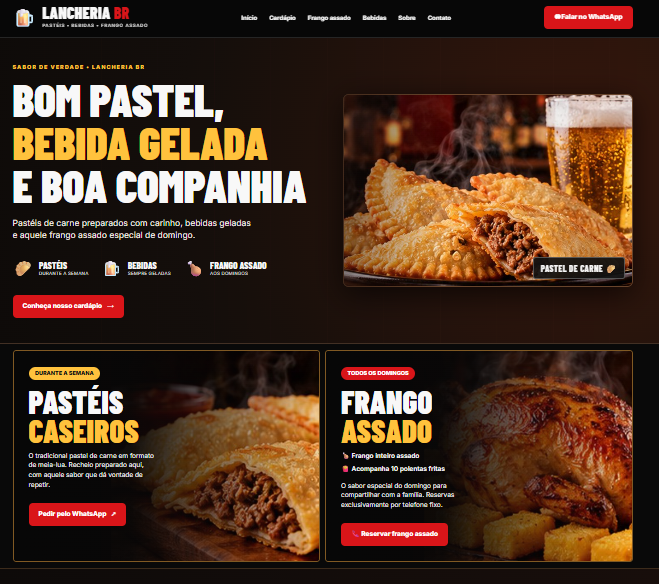
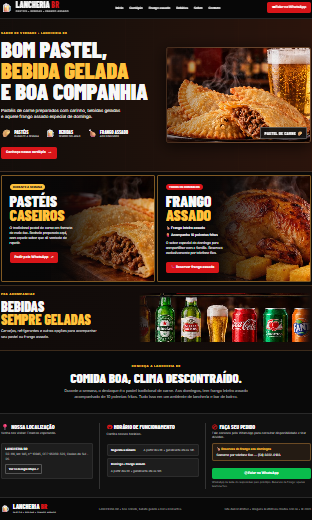
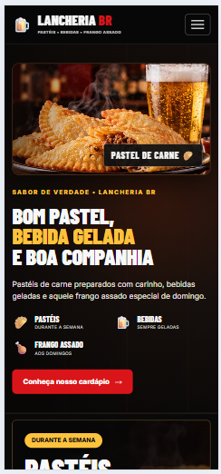

# 🍴 LANCHERIA BR — Site responsivo

Site institucional estático desenvolvido para apresentar uma lancheria e bar de bairro em Caxias do Sul (RS), com destaque para os **pastéis de carne durante a semana** e o **frango inteiro assado acompanhado de 10 polentas fritas aos domingos**.

O projeto foi desenvolvido como demonstração de frontend para portfólio. As imagens utilizadas são ilustrativas.

## 📸 Prévia do projeto

### Desktop



### Página completa



### Mobile



## 🛠️ Tecnologias

- **HTML5:** estrutura semântica do conteúdo.
- **CSS3:** layout com Grid, Flexbox e media queries.
- **JavaScript puro:** menu mobile, configuração dos dados de contato, links e atualização automática do ano.

Não utiliza frameworks, backend, banco de dados ou ferramentas de build.

## ✨ Funcionalidades

- Layout responsivo para desktop e dispositivos móveis.
- Menu mobile recolhível.
- Navegação entre seções e links para voltar ao início da página.
- Apresentação de pastéis, frango assado e bebidas.
- Botões de WhatsApp com mensagens pré-preenchidas, utilizando um número de teste autorizado.
- Botão para reserva de frango por ligação telefônica.
- Link de pesquisa do endereço no Google Maps.
- Endereço e horários configuráveis pelo JavaScript.
- Recursos básicos de acessibilidade, como link para pular ao conteúdo, textos alternativos e estados de foco.

## 📁 Estrutura do projeto

```text
lancheria-br/
├── assets/
│   ├── bebidas.jpg
│   ├── frango.jpg
│   ├── hero-pasteis.jpg
│   └── pasteis.jpg
├── screenshots/
│   ├── desktop.png
│   ├── mobile.png
│   └── pagina-completa.png
├── index.html
├── styles.css
├── script.js
└── README.md
```

## 🚀 Como executar

1. Baixe ou clone o repositório.
2. Abra a pasta no Visual Studio Code.
3. Abra `index.html` no navegador ou utilize a extensão **Live Server**.

Não é necessário instalar dependências.

## ⚙️ Como personalizar

No início do arquivo `script.js`, altere o objeto `CONFIG`:

- `whatsapp`: número autorizado no formato `55 + DDD + número`, somente dígitos.
- `endereco`: endereço completo exibido no site e utilizado na pesquisa do Google Maps.
- `horarioSemana`: horário aproximado durante a semana.
- `horarioDomingo`: horário aproximado aos domingos.

Outras informações, como textos dos produtos e telefone de reserva de frango, podem ser ajustadas diretamente no `index.html`.

**Importante:** não utilize números de telefone de terceiros sem autorização. Antes de reutilizar o modelo em outro estabelecimento, substitua todos os dados de contato e confira o funcionamento dos botões.

## 📍 Informações exibidas nesta versão

- **Endereço:** BR-116, km 145, nº 15945, CEP 95059-520, Caxias do Sul — RS.
- **Horários aproximados:** todos os dias a partir das 6h, geralmente até as 18h; sujeitos a alterações conforme o movimento.
- **WhatsApp:** (54) 99161-6996 — número de teste do responsável pelo protótipo, não apresentado como canal oficial da lancheria.
- **Reservas de frango assado:** telefone fixo (54) 3222-0183.
- **Google Maps:** link de pesquisa pelo endereço informado. A localização exata do estabelecimento ainda precisa ser confirmada.

## 🖼️ Imagens e créditos

As imagens de produtos em `assets/` são **ilustrações geradas por IA**, armazenadas localmente. Não representam necessariamente fotografias dos produtos, do ambiente ou das marcas comercializadas pela lancheria.

As imagens em `screenshots/` mostram a interface do projeto em desktop e mobile.

Antes de usar o site como representação comercial definitiva, recomenda-se substituir as ilustrações por fotografias autorizadas do estabelecimento e confirmar as informações divulgadas.

## ♿ Responsividade e acessibilidade

O layout foi adaptado para diferentes tamanhos de tela, incluindo menu mobile, organização vertical dos cartões e ajustes nas seções de bebidas e apresentação. Também foi corrigida a navegação de retorno ao topo.

O projeto utiliza HTML semântico e alguns recursos básicos de acessibilidade, mas isso não substitui uma auditoria completa nem testes em dispositivos reais.

## 🌐 Publicação

O site pode ser hospedado gratuitamente no **GitHub Pages**, pois é composto apenas de HTML, CSS, JavaScript e imagens locais.

Para publicar ou atualizar uma cópia:

1. Envie os arquivos para um repositório do GitHub.
2. Em **Settings → Pages**, selecione **Deploy from a branch**.
3. Escolha a branch `main` e a pasta `/ (root)`.
4. Salve e aguarde a publicação.

## 📌 Status

**Versão de portfólio — revisão de responsividade e navegação.**

O site já possui uma publicação no GitHub Pages; as alterações mais recentes e as capturas de tela precisam ser enviadas ao repositório para aparecerem na versão online.

Antes de considerar a versão comercial definitiva, ainda é necessário confirmar os dados do estabelecimento e testar os recursos em dispositivos reais.

## 👨‍💻 Autor

Projeto desenvolvido para demonstração de habilidades em desenvolvimento frontend e composição de portfólio profissional.
